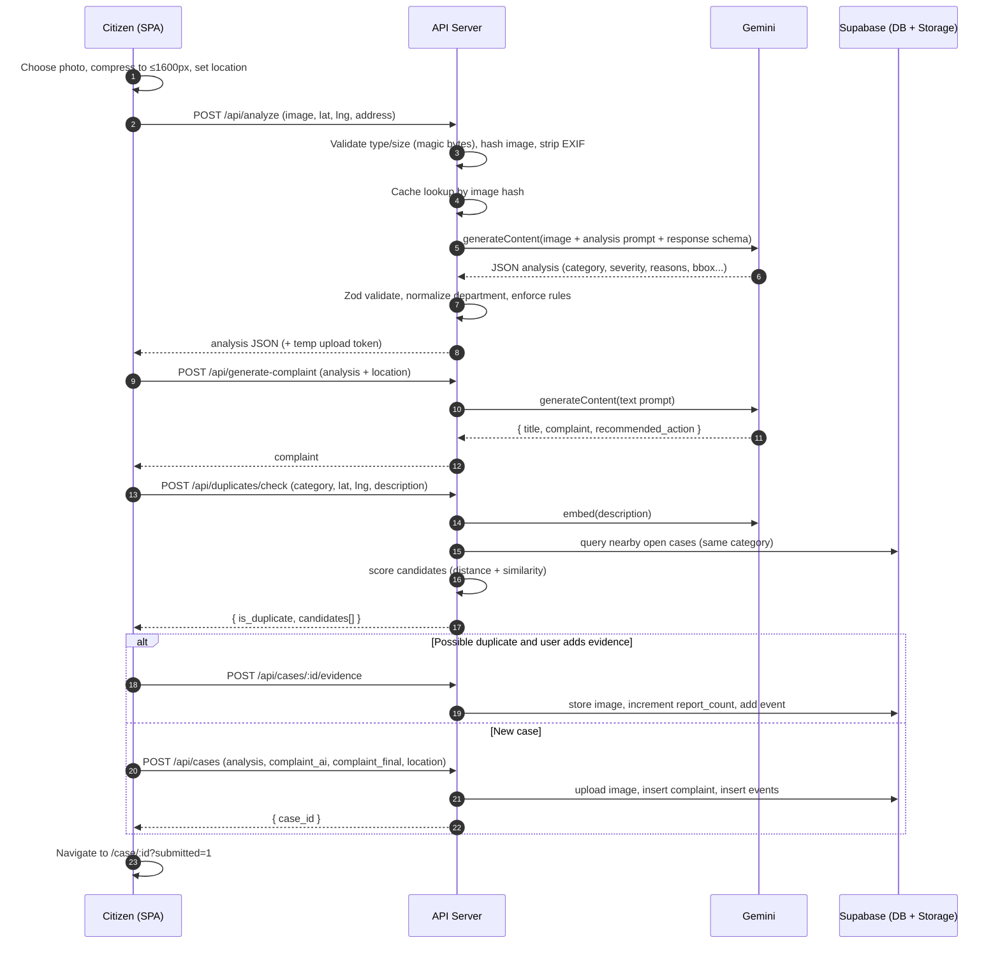
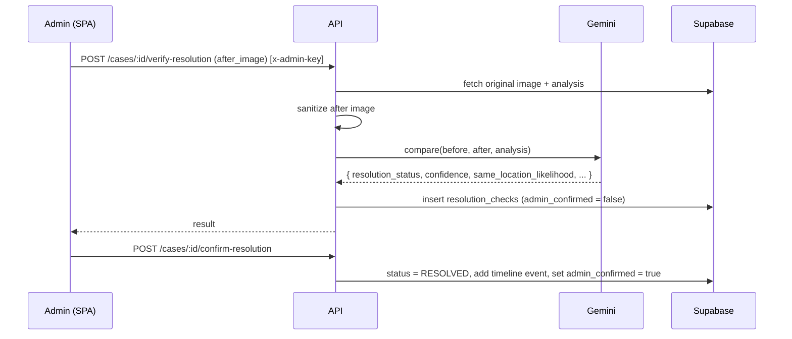

# CivicLens AI — Architecture

**Companions:** `PRD.md` (what to build), `DESIGN.md` (how it looks), `SKILL.md` (how Claude builds it)
**Scope:** system structure, components, data flow, data model, AI pipeline, security, deployment, operations, and the reasoning behind key decisions.
**Status:** v1.0, aligned with PRD v1.0 and DESIGN v1.0.

---

## 1. Goals and Constraints

### 1.1 Architectural goals
| Goal | What it means in practice |
|------|---------------------------|
| **Simple to build and demo** | Few moving parts: one SPA, one API, one managed backend (Supabase), one AI provider. |
| **AI is the core, and visible** | AI calls are explicit pipeline stages with typed inputs and outputs, not hidden helpers. |
| **Trustworthy output** | Every AI result is schema-validated, has a confidence value, and can be edited or overridden by a human. |
| **Safe by default** | Secrets stay on the server, images are sanitized, endpoints are rate limited, admin actions are gated. |
| **Measurable** | The system records what it needs for evaluation (AI vs. edited text, duplicate decisions, latency, time to submit). |
| **Replaceable parts** | Gemini, the map provider, and storage sit behind thin service interfaces so each can be swapped. |

### 1.2 Constraints
- Solo or small-team build; hackathon and award deadlines (about 7 weeks to the 15 December submission).
- Free or low-cost tiers: Vercel, Render or Railway, Supabase, Mapbox free tier, Gemini API quota.
- No real municipal integration; department routing is simulated.
- No user accounts in v1; anonymous reporting plus a demo-grade admin passcode.

### 1.3 Non-goals
Multi-tenancy, real-time collaboration, native apps, custom ML training, and production-grade identity management. Section 16 lists the evolution path for each.

---

## 2. System Context

```
                        ┌────────────────────┐
                        │   Citizen (web /   │
                        │   mobile browser)  │
                        └─────────┬──────────┘
                                  │ HTTPS
┌────────────────┐        ┌───────▼────────┐        ┌────────────────────┐
│ Admin (demo)   │──────▶ │   CivicLens    │ ─────▶ │  Google Gemini API │
│ passcode-gated │ HTTPS  │   Web App +    │  HTTPS │  vision, text,     │
└────────────────┘        │   API          │        │  embeddings        │
                          └───┬────────┬───┘        └────────────────────┘
                              │        │
                    ┌─────────▼──┐  ┌──▼────────────────┐   ┌─────────────────┐
                    │ Supabase   │  │ Supabase Storage  │   │ Mapbox (tiles,  │
                    │ Postgres   │  │ (evidence images) │   │ geocoding)      │
                    └────────────┘  └───────────────────┘   └─────────────────┘
```

**External systems:** Gemini API (AI), Supabase (database and file storage), Mapbox (map tiles and optional geocoding). Browsers call Mapbox directly with a public, URL-restricted token. Everything else goes through the CivicLens API.

---

## 3. Container View

```
┌──────────────────────────── Browser ─────────────────────────────┐
│  React SPA (Vite, TypeScript)                                    │
│  • Pages: Home, Report, Analysis, Case, Dashboard, Admin, Metrics │
│  • State: TanStack Query (server state), local state (forms)     │
│  • Map: Mapbox GL JS      • Charts: Recharts                      │
└───────────────┬──────────────────────────────────────────────────┘
                │ JSON over HTTPS, multipart for images
┌───────────────▼──────────────────────────────────────────────────┐
│  API Server (Node.js, Express, TypeScript)                       │
│                                                                  │
│  middleware: helmet · cors · rate-limit · request-id · logger    │
│              · adminAuth · multer · errorHandler                 │
│                                                                  │
│  routes ──▶ services ──▶ repositories                            │
│   analyze     gemini        casesRepo                            │
│   complaints  duplicate     evidenceRepo                         │
│   cases       image         eventsRepo                           │
│   duplicates  caseId        resolutionRepo                       │
│   admin       embeddings    metricsRepo                          │
│   stats       resolution                                         │
└──────┬───────────────────────────┬───────────────────────────────┘
       │                           │
┌──────▼───────────┐       ┌───────▼──────────┐
│ Gemini API       │       │ Supabase         │
│ (@google/genai)  │       │ Postgres+Storage │
└──────────────────┘       └──────────────────┘
```

### 3.1 Responsibilities

| Container | Owns | Does not own |
|-----------|------|--------------|
| **React SPA** | Rendering, form state, client-side image compression, map interaction, optimistic UI | Secrets, AI calls, business rules, severity decisions |
| **API server** | Validation, orchestration of AI calls, duplicate logic, case lifecycle, auth for admin, image sanitization, metrics | Rendering, map tiles |
| **Gemini** | Image understanding, text generation, embeddings, image comparison | Persistence, decisions about case status |
| **Supabase** | Durable data, image files, optional realtime | Business logic |

**Rule:** the SPA never talks to Gemini or to Supabase with a privileged key. It talks only to the API (plus Mapbox tiles with a public token).

---

## 4. Code Structure and Layering

### 4.1 Server layers
```
HTTP (routes)  →  Services (business logic)  →  Repositories (DB/Storage)  →  Supabase
                         │
                         └──────────▶  Integrations (Gemini client)
```
- **Routes:** parse and validate the request (Zod), call one service function, shape the response. No business logic.
- **Services:** the rules of the product (analysis pipeline, duplicate scoring, case creation). Pure where possible, so they are easy to unit test.
- **Repositories:** all SQL and storage calls. Services never import the Supabase client directly.
- **Integrations:** the Gemini wrapper (`gemini.ts`) is the only file that imports the AI SDK.

### 4.2 Directory layout
```
server/src/
├── index.ts                # app bootstrap, middleware, route mounting
├── config/env.ts           # Zod-validated environment config (fails fast)
├── routes/
│   ├── analyze.ts          # POST /api/analyze
│   ├── complaints.ts       # POST /api/generate-complaint
│   ├── duplicates.ts       # POST /api/duplicates/check
│   ├── cases.ts            # CRUD, evidence, list, detail
│   ├── admin.ts            # status, verify/confirm resolution
│   └── stats.ts            # /api/stats, /api/metrics, /api/health
├── services/
│   ├── analysis.service.ts     # image → validated analysis
│   ├── complaint.service.ts    # analysis → complaint
│   ├── duplicate.service.ts    # candidates + scoring
│   ├── case.service.ts         # create case, add evidence, lifecycle
│   ├── resolution.service.ts   # before/after check
│   ├── image.service.ts        # validate, strip EXIF, resize, hash
│   ├── caseId.service.ts
│   └── stats.service.ts
├── integrations/
│   └── gemini.ts           # generateJSON(), embed(), compareImages()
├── prompts/                # versioned prompt constants
├── schemas/                # Zod schemas shared by routes and services
├── repositories/           # *.repo.ts
├── middleware/             # adminAuth, rateLimit, requestId, errorHandler, upload
├── db/schema.sql           # DDL and indexes
└── utils/                  # geo.ts (haversine), cosine.ts, logger.ts
server/scripts/             # seed.ts, evaluate.ts, evaluateDuplicates.ts
```

### 4.3 Client structure
```
client/src/
├── app/           # router, providers (QueryClient, Theme), AppShell
├── pages/         # route-level components
├── features/
│   ├── report/        # upload, location, analysis flow state machine
│   ├── cases/         # list, detail, timeline, duplicate UI
│   ├── map/           # CivicMap, layers, popup
│   ├── dashboard/     # KPI, filters, table, donut
│   └── admin/
├── components/    # shared UI (SeverityBadge, KpiCard, EvidenceViewer ...)
├── lib/           # api client, geo, image compression, formatters
├── hooks/         # useCases, useStats, useGeolocation ...
└── styles/        # tokens (index.css), Tailwind config
```

### 4.4 Shared types
Zod schemas in `server/src/schemas/` are the source of truth. Generate TypeScript types from them and share with the client (a small `packages/shared` workspace, or copy generated types into `client/src/types`). This keeps the API contract and UI types from drifting apart.

---

## 5. Core Flows

### 5.1 Report a new issue (happy path)



**Notes**
- The image is sent once to `/analyze`. The server keeps the sanitized copy in a short-lived staging area keyed by an upload token, so `/cases` does not need the client to upload it again. Staging objects expire after 1 hour.
- Analysis and complaint generation are separate calls so the user can edit the complaint and regenerate it without re-analyzing the image.
- `/duplicates/check` runs before submission, and its result is logged to `duplicate_decisions` when the user decides.

### 5.2 Analysis pipeline (inside `/api/analyze`)

```
 upload ─▶ validate ─▶ sanitize ─▶ hash ─▶ cache? ──hit──▶ return cached
                                              │ miss
                                              ▼
                                     Gemini (image + prompt + schema)
                                              │
                                              ▼
                                   parse JSON ─▶ Zod validate
                                              │ invalid → retry once → error
                                              ▼
                                   post-process rules:
                                    • department → fixed list
                                    • category "None detected" → flag, no complaint
                                    • confidence < 0.5 → needs_verification = true
                                    • bbox out of range → drop bbox
                                    • derive target_response from urgency
                                              ▼
                                   cache result (image hash) ─▶ respond
```

Post-processing is deliberate. Gemini's output is treated as untrusted input, validated and normalized before it reaches the UI or the database.

### 5.3 Resolution verification


The AI never changes case status on its own. Confirmation is an explicit admin action.

### 5.4 Dashboard reads
- `GET /api/stats` returns totals, severity breakdown, category distribution, resolution rate, and average resolution hours. It is computed by SQL aggregates and cached for 30 seconds in memory.
- `GET /api/cases` returns paginated, filterable rows with thumbnail URLs. Map markers use a lighter endpoint variant (`?fields=map`) returning only id, coordinates, category, severity, status, so thousands of points stay cheap.
- The client polls every 30 seconds (TanStack Query `refetchInterval`). Supabase Realtime is an optional upgrade (Section 16).

---

## 6. Data Architecture

### 6.1 Entity relationships
```
complaints 1 ──── * evidence            (original, additional, after photos)
complaints 1 ──── * case_events         (timeline)
complaints 1 ──── * resolution_checks   (AI before/after results)
complaints 1 ──── * duplicate_decisions (by candidate_case_id, logged per decision)
sessions_metrics                        (independent, anonymous usage metrics)
```
Full DDL is in `PRD.md` section 9.1 and lives in `server/src/db/schema.sql`. This section covers the decisions around it.

### 6.2 Key design decisions
- **`case_id` is a public identifier, `id` (UUID) is internal.** URLs and users see `CV-2026-8F42A`. Joins use the UUID.
- **Timeline as an event log.** `case_events` is append-only. Current status lives on `complaints.status` for fast filtering, and every change also writes an event, so history is never lost.
- **AI output stored whole.** Analysis fields are columns for filtering (category, severity, department, urgency), and `severity_reasons` is `jsonb`. The raw validated Gemini response is also kept in `ai_raw jsonb` for evaluation and debugging.
- **Two complaint columns.** `complaint_text_ai` and `complaint_text_final` allow measuring edit ratio.
- **Embeddings.** Store `description_embedding` with **pgvector**. The vector dimension must match the embedding model's output size, so make it a migration parameter rather than hard-coding 768. Index with `ivfflat` or `hnsw` only after the table passes a few thousand rows. At hackathon scale, a distance prefilter makes an unindexed scan fast enough.
- **Geospatial search.** Start with a bounding-box prefilter on `(latitude, longitude)` plus Haversine in application code. If the dataset grows, enable PostGIS and use `ST_DWithin` with a GiST index. The prefilter is: `latitude BETWEEN lat ± Δ AND longitude BETWEEN lng ± Δ`, where Δ is derived from the radius.
- **Soft states, no hard deletes.** Cases are never deleted by the app. Admin scripts handle removal on request (privacy).

### 6.3 Storage layout (Supabase Storage)
```
bucket: evidence            (public read, write via service key only)
  <caseId>/original-<ts>.jpg
  <caseId>/additional-<ts>.jpg
  <caseId>/after-<ts>.jpg
bucket: staging             (private, 1-hour TTL via scheduled cleanup)
  <uploadToken>.jpg
```
Public read is acceptable because images are sanitized (no EXIF) and the object path contains an unguessable case id plus timestamp. If privacy requirements tighten, switch to signed URLs (Section 16).

### 6.4 Indexes
```
complaints(status), (category), (severity), (created_at desc), (latitude, longitude)
case_events(complaint_id, created_at)
evidence(complaint_id)
```
Add a composite `(category, status)` index if duplicate queries become slow.

### 6.5 Data retention
- Staging images: 1 hour.
- Analysis cache entries: 24 hours.
- Cases and evidence: kept until an admin removes them on request.
- Logs: 14 days.

---

## 7. AI Architecture

### 7.1 Where Gemini is used

| Stage | Input | Output | Validation |
|-------|-------|--------|-----------|
| Analysis | Image + analysis prompt + location context | Category, severity, confidence, description, hazard, department, urgency, reasons, flags, optional bbox/road type | Zod schema, enum checks, range checks |
| Complaint | Validated analysis + location | Title, complaint, recommended action | Zod schema, length limits (80-150 words) |
| Embeddings | Description text | Vector | Dimension check |
| Duplicate image comparison (optional) | Two images | same_issue YES/NO/UNCERTAIN + reason | Zod schema |
| Resolution check | Before image, after image, analysis | Resolution status, confidence, summaries, same-location likelihood | Zod schema |

### 7.2 Gemini client wrapper (`integrations/gemini.ts`)
A single module exposes:
```ts
generateJSON<T>(opts: { prompt: string; images?: ImagePart[]; schema: ZodSchema<T>;
                        responseSchema: object; temperature: number }): Promise<T>
embed(text: string): Promise<number[]>
```
It handles: model selection from env, structured-output configuration, timeouts (30 s), one retry with exponential backoff on 429/5xx, JSON parse and Zod validation with one repair retry, latency and token logging, and error mapping to application error codes (`AI_TIMEOUT`, `AI_INVALID_OUTPUT`, `AI_QUOTA`). Nothing else in the codebase imports the SDK.

### 7.3 Trust and safety controls around the model
- **Untrusted output:** schema validation, enum clamping, department normalization, bbox range checks.
- **Grounding rules in prompts:** describe only what is visible; use `None detected` when unsure; never invent details.
- **Prompt injection through images:** text visible in a photo (a sign or note) is treated as image content, never as instructions. The system prompt states this, and outputs are schema-bound, so injected text cannot add new fields or actions.
- **Human in the loop:** the user edits the complaint before submission; the admin confirms resolution.
- **Low confidence handling:** below 0.5 the UI asks the user to verify or choose the category.
- **Privacy flag:** `contains_people_or_plates` triggers a warning; blurring is a later enhancement.
- **No sensitive inference:** prompts do not ask about identities, and the output schema has no field for them.

### 7.4 Cost and quota management
- Client-side compression to 1600px before upload.
- Cache analysis by SHA-256 of the sanitized image (24 hours).
- Per-IP rate limiting on AI endpoints; a global concurrency cap (for example 5 simultaneous Gemini calls) with a small queue.
- Log token usage per stage so the evaluation report can state cost per case.
- A kill switch env var (`AI_ENABLED=false`) puts the app in manual mode: users pick the category and write the complaint themselves. This keeps demos alive during quota problems.

### 7.5 Prompt and model versioning
Prompts are constants with a `PROMPT_VERSION` string, stored with each analysis (`analysis_prompt_version`, `model_name`). When evaluation numbers are reported, they cite the exact prompt version and model. Changing a prompt means bumping the version and re-running `evaluate.ts`.

---

## 8. Duplicate Detection Design

```
new report ──▶ candidate query ──▶ score ──▶ threshold ──▶ UI decision
```
1. **Candidate query (SQL):** same `category`; `status != RESOLVED` or resolved within 7 days; latitude/longitude inside the bounding box for `DUP_RADIUS_M`.
2. **Distance:** Haversine in the service, drop anything beyond the radius.
3. **Similarity:** cosine similarity between the new description embedding and each candidate's stored embedding (pgvector `<=>` in SQL, or in-process for small sets).
4. **Score:** `0.5 × proximity + 0.2 × category_match + 0.3 × similarity`.
5. **Threshold:** `DUP_SCORE_THRESHOLD` (default 0.65). Candidates between 0.5 and 0.8 may optionally go through the Gemini image comparison to confirm.
6. **Accuracy-aware radius:** if the reported location accuracy is above 50 m, widen the radius to 150 m and mark the match as lower confidence.
7. **Outcome:** the user chooses "Add my photo to this case" or "This is a different issue"; both choices are stored for tuning.

The function is pure (`scoreCandidates(newCase, candidates, config)`), which makes it unit-testable with fixed inputs.

---

## 9. API Design

### 9.1 Conventions
- Base path `/api`, JSON bodies, `multipart/form-data` for image endpoints.
- Success: `200/201` with the resource. Errors use one shape:
  ```json
  { "error": { "code": "AI_TIMEOUT", "message": "Analysis took too long. Try again or pick the category yourself.", "requestId": "..." } }
  ```
- Error codes: `VALIDATION_ERROR`, `UNSUPPORTED_MEDIA`, `FILE_TOO_LARGE`, `RATE_LIMITED`, `AI_TIMEOUT`, `AI_INVALID_OUTPUT`, `AI_QUOTA`, `NOT_FOUND`, `UNAUTHORIZED`, `INTERNAL`.
- Every response carries `x-request-id`; the same id appears in server logs.
- Pagination: `page`, `pageSize` (max 50) with `{ items, total, page, pageSize }`.
- Versioning: unversioned in v1. If the API is exposed to third parties, move to `/api/v1`.

### 9.2 Endpoint summary
See `PRD.md` section 10 for the full list. Architecture-level notes:
- Idempotency: `POST /api/cases` accepts an `Idempotency-Key` header (the client generates a UUID per submission) so a double-click or retry cannot create two cases.
- Admin endpoints require `x-admin-key` and are rate limited more strictly.
- `GET /api/health` returns app status, DB connectivity, and `ai_enabled`, with no secrets.

---

## 10. Security Architecture

### 10.1 Threat model (summary)

| Threat | Mitigation |
|--------|-----------|
| Leaked API keys | Keys only in server env; `.env` ignored by git; secret scanning in CI; client has only public tokens |
| Abuse of AI endpoints (cost, quota) | Per-IP rate limits, global concurrency cap, file size limits, optional CAPTCHA if abused |
| Malicious uploads | Magic-byte type check, size limit, re-encode through Sharp (removes payloads), reject animated or oversized dimensions |
| Privacy leak through image metadata | EXIF/GPS stripped before storage |
| Faces or number plates in photos | User notice, AI flag, planned blurring |
| Unauthorized status changes | `x-admin-key` check with constant-time comparison; strict rate limits; audit events |
| Prompt injection via text in photos | Treat as image content, schema-bound outputs, no tool use or actions driven by model output |
| SQL injection | Parameterized queries via the Supabase client; no string-built SQL |
| XSS | React escaping; user-edited complaint text is rendered as text, never as HTML; CSP header |
| CSRF | No cookie-based auth; admin key sent in a header |
| Enumeration of cases | IDs are random 5-character codes (about 33M combinations); no personal data exposed; rate limiting on case lookups |
| Fake or spam reports | Rate limits, `None detected` gating, low-confidence verification, admin review |

### 10.2 Hardening checklist
- Helmet with a CSP that allows only the app origin, Mapbox, Supabase storage, and fonts.
- CORS allow-list from `CLIENT_ORIGIN`.
- Mapbox token restricted by URL in the Mapbox dashboard.
- Supabase: Row Level Security enabled on all tables; the API uses the service key server-side only; the anon key is not shipped to the client in v1.
- Dependencies: `npm audit` in CI; Dependabot or Renovate.
- Logs never contain image bytes, API keys, or the admin passcode.

### 10.3 Known limitations (documented, not hidden)
- The admin passcode is demo-grade. Production needs real auth (Supabase Auth with roles).
- Case pages are viewable by anyone who has the Case ID.
- Public image URLs rely on unguessable paths, not authentication.

---

## 11. Privacy Architecture

- **Data minimization:** no names, phone numbers, or accounts in v1. Only the photo, location, and complaint text are stored.
- **Location handling:** the user confirms the location; device GPS in EXIF is discarded.
- **Retention and deletion:** a script (`scripts/purge-case.ts <caseId>`) deletes the case, evidence files, events, and checks.
- **Transparency:** the report screen states what is stored and that images are processed by Google's Gemini API. Check Google's current data-use terms for the API tier you use, and describe them accurately in the privacy notice.
- **Public data:** case summaries on the dashboard and map show category, severity, status, and approximate location, but not the editable personal text beyond the complaint itself.

---

## 12. Deployment Architecture

```
            ┌──────────────┐
 Browser ──▶│  Vercel CDN  │  static SPA (client/dist)
            └──────┬───────┘
                   │ /api/*  (VITE_API_URL)
            ┌──────▼────────┐        ┌─────────────────────┐
            │ Render/Railway│──────▶ │ Supabase (Postgres, │
            │ Node API      │        │ Storage)            │
            │ (1+ instances)│──────▶ │ Gemini API          │
            └───────────────┘        └─────────────────────┘
```

### 12.1 Environments
| Environment | Purpose | Notes |
|-------------|---------|-------|
| Local | Development | `.env` files; Supabase project in dev mode or local stack |
| Staging (optional) | Pre-demo testing | Separate Supabase project and Gemini key |
| Production | Demo, pilot, award submission | Seeded with clearly labelled demo data |

### 12.2 Configuration (server)
Validated at startup with Zod; the process exits if anything required is missing.
```
NODE_ENV, PORT, CLIENT_ORIGIN
GEMINI_API_KEY, GEMINI_MODEL, GEMINI_EMBEDDING_MODEL, AI_ENABLED, AI_MAX_CONCURRENCY
SUPABASE_URL, SUPABASE_SERVICE_KEY
ADMIN_PASSCODE
DUP_RADIUS_M=100, DUP_SCORE_THRESHOLD=0.65
RATE_LIMIT_ANALYZE_PER_MIN=10
LOG_LEVEL
```
Client: `VITE_API_URL`, `VITE_MAPBOX_TOKEN`.

### 12.3 CI/CD
- GitHub Actions on pull request: install, `tsc --noEmit`, ESLint, unit tests, build both packages, `npm audit --audit-level=high`.
- On merge to `main`: Vercel and Render/Railway auto-deploy from the repo.
- Database migrations: SQL files in `server/src/db/migrations/` applied via the Supabase CLI or dashboard before deploying code that depends on them.

### 12.4 Hosting caveats
- Free-tier backends sleep when idle. Before demos, hit `/api/health` to warm the server, or use a paid instance during the demo window.
- Set request timeouts above the Gemini timeout (for example 45 seconds at the platform and proxy levels).

---

## 13. Observability and Operations

### 13.1 Logging
Structured JSON logs (pino): timestamp, level, request id, route, status, duration, plus domain fields (`caseId`, `geminiStage`, `geminiLatencyMs`, `tokens`, `cacheHit`). Never log image data or secrets.

### 13.2 Metrics to track
| Metric | Why |
|--------|-----|
| Gemini latency per stage (p50/p90/p99) | Meets the 10 s target; informs UX |
| AI error rate by code | Detect quota, schema failures |
| Cache hit rate | Cost control |
| Analyses per day, cases per day | Pilot usage |
| Duplicate suggestions accepted vs. overridden | Threshold tuning |
| Complaint edit ratio | Quality signal for the evaluation report |
| Time to submit | Headline efficiency number for the award |

These feed the admin `/metrics` page (PRD F13) and the award report.

### 13.3 Health and alerting
- `/api/health` for uptime checks (UptimeRobot or the host's monitor).
- Alert on repeated 5xx or `AI_QUOTA` errors.
- Client errors captured with an error boundary and optionally Sentry's free tier.

### 13.4 Backups
Supabase automatic backups (as per plan). Before the final demo or submission, export a database dump and a copy of the storage bucket.

---

## 14. Performance and Scalability

### 14.1 Targets
- Analysis p90 under 10 s; complaint generation under 4 s; list endpoints under 300 ms at 10k cases; LCP under 2.5 s on 4G.

### 14.2 Techniques
- Client: image compression, lazy-loaded map and charts, TanStack Query caching, skeleton loaders, thumbnail images served at 2x display size.
- Server: in-memory cache for stats (30 s) and analysis (24 h), gzip/br compression, projection queries for map data, pagination everywhere.
- Database: indexes in 6.4, bounding-box prefilters before distance math, aggregate queries instead of client-side counting.
- Map: clustering above a few hundred markers; heatmap uses a weighted point layer.

### 14.3 Scaling path
| Pressure | Response |
|----------|----------|
| More API traffic | Scale API instances horizontally (stateless), move the analysis cache to Redis |
| Gemini quota or latency | Queue analysis jobs, show progress via polling, add provider fallback or batch endpoints |
| Large case tables | PostGIS + GiST index, pgvector HNSW index, partition by month |
| Many images | CDN in front of Storage, generate thumbnails on upload |
| Real-time dashboards | Supabase Realtime subscriptions or server-sent events |

---

## 15. Testing Strategy

| Level | Scope | Tools |
|-------|-------|-------|
| Unit | Pure functions: haversine, cosine, duplicate scoring, case ID generation, department normalization, schema validation | Vitest |
| Integration | Routes with a test DB and a **mocked Gemini client** (fixtures for good, malformed, low-confidence, and none-detected outputs) | Vitest + Supertest |
| Contract | Zod schemas versus recorded real Gemini responses | Vitest fixtures |
| Component | Key UI pieces (EvidenceViewer, AnalysisPanel, DuplicateStrip, Timeline) | Vitest + Testing Library |
| End to end | Report flow, duplicate flow, admin resolution flow | Playwright (with mocked AI mode for determinism) |
| AI quality | Accuracy, F1, severity agreement, duplicate precision/recall on a labelled set | `evaluate.ts`, `evaluateDuplicates.ts` |
| Accessibility | Automated checks and manual keyboard pass | axe, Playwright |
| Security | Secret scan, dependency audit, upload fuzz cases (wrong type, huge file, corrupt image) | CI jobs, manual tests |

AI quality evaluation is separate from functional tests. It is slow, uses real API calls, and runs on demand, never on every commit.

---

## 16. Evolution Path

| Capability | v1 | Next step |
|-----------|----|-----------|
| Auth | Admin passcode | Supabase Auth, roles (citizen, department, admin), row-level policies |
| Notifications | None | Email/WhatsApp status updates |
| Department integration | Simulated mapping | Adapter interface per municipality (API or form submission) |
| Real-time | Polling | Supabase Realtime |
| Privacy | EXIF strip, warnings | Automatic face/plate blurring, signed URLs |
| Languages | English | Multi-language complaints and voice input |
| Analytics | Basic stats | Hotspot prediction, trend reports |
| Offline | None | PWA with queued uploads |
| AI provider | Gemini | Provider interface with fallback model |

---

## 17. Architecture Decision Records

**ADR-1: Separate SPA and API instead of a full-stack framework.**
Reason: clear separation (keys stay server-side), matches the stack already planned, deploys independently on free tiers. Trade-off: two deployables and CORS configuration.

**ADR-2: Supabase for database and storage.**
Reason: managed Postgres with pgvector and Storage in one place, free tier, minimal operations. Trade-off: vendor coupling, mitigated by repositories hiding the client.

**ADR-3: Gemini called only from the server, behind one wrapper.**
Reason: protects the key, centralizes retries, validation, caching, and logging, and makes a provider swap or mock trivial. Trade-off: the server is on the latency path.

**ADR-4: Analysis and complaint generation as two calls.**
Reason: users edit and regenerate text without re-running vision; each stage is separately testable and measurable. Trade-off: one extra round trip (about 2-4 s).

**ADR-5: Schema-validated, human-confirmed AI.**
Reason: model output is untrusted; the user edits complaints and the admin confirms resolution. Trade-off: extra UI steps, accepted as the core of the responsible-AI story.

**ADR-6: Embeddings plus distance for duplicates, not image hashing alone.**
Reason: two photos of the same defect from different angles do not match by perceptual hash. Combining location, category, and description similarity is more robust. Optional Gemini image comparison handles ambiguous cases. Trade-off: embedding cost per report (small).

**ADR-7: Bounding-box prefilter before Haversine, PostGIS later.**
Reason: simple and fast at demo scale without extension setup. Trade-off: replace when the dataset grows.

**ADR-8: Mapbox GL JS for the map.**
Reason: matches the reference design (satellite, terrain, clusters, heatmap) with a free tier. Trade-off: needs a public token and has usage terms; MapLibre GL is the drop-in fallback because the layer logic is isolated in `features/map`.

**ADR-9: Polling instead of realtime in v1.**
Reason: fewer moving parts and enough for the demo. Trade-off: up to 30 seconds of staleness.

**ADR-10: Anonymous reporting in v1.**
Reason: lowest friction and least personal data. Trade-off: weaker spam control and no per-user history; mitigated by rate limits and the path to accounts in Section 16.

---

## 18. Risks Specific to the Architecture

| Risk | Impact | Mitigation |
|------|--------|-----------|
| Gemini latency spikes | Poor demo, timeouts | Timeout and retry, progress UI, manual mode, pre-warmed demo cases |
| Gemini quota exhaustion | Blocked analysis | Cache, rate limits, concurrency cap, `AI_ENABLED` kill switch |
| Model output drift after a model update | Accuracy changes unnoticed | Pin model name in env, record model and prompt version per analysis, re-run evaluation on change |
| Embedding dimension mismatch after a model change | Duplicate search errors | Dimension recorded in config; migration to re-embed existing rows |
| Free-tier cold starts | Slow first request | Health-check warmup, paid instance during demos |
| Public image bucket exposure | Privacy concern | EXIF removal, unguessable paths, move to signed URLs if needed |
| Case ID guessing | Information exposure | Rate limiting, no personal data stored; widen ID length if abuse appears |
| Time pressure | Unfinished phases | Strict phase gates from the PRD; Phase 1 must work end to end before anything else |

---

## 19. Quick Reference

**Critical path:** SPA → `/api/analyze` → Gemini → validation → `/api/generate-complaint` → `/api/duplicates/check` → `/api/cases` → Supabase.

**One-line rules**
- Only the server talks to Gemini and holds privileged keys.
- All AI output is validated, normalized, and advisory.
- Services contain the rules; routes and repositories stay thin.
- Every decision that affects evaluation is logged.
- If AI is unavailable, the app still works in manual mode.
